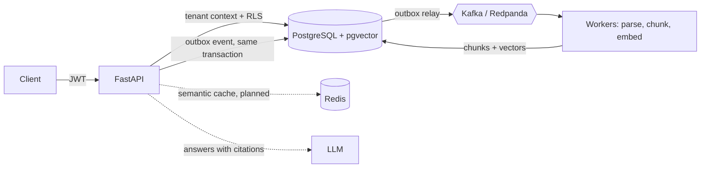

<!--
  GitHub PROFILE README for github.com/im-abhyuday
  Special repository: im-abhyuday/im-abhyuday
-->

 

  

<b>
<a href="#about-me">About</a> &nbsp;•&nbsp;
<a href="#featured-project">Project</a> &nbsp;•&nbsp;
<a href="#tech-stack">Tech</a> &nbsp;•&nbsp;
<a href="#github-stats">Stats</a> &nbsp;•&nbsp;
<a href="#lets-connect">Contact</a>
</b>

---

## 👋 About me

I'm a final-year B.Tech CSE student who likes building systems that keep working after the demo ends: access control that is enforced in the database, pipelines that survive crashes, and ML features you can actually explain.

- 🔭 Currently building **[Vaultly](https://github.com/im-abhyuday/Vaultly)**, a multi-tenant RAG platform with built-in evaluation
- 🎯 Looking for **off-campus SDE / backend / GenAI engineering** roles
- 📚 Digging into: PostgreSQL row-level security, Kafka delivery guarantees, RAG evaluation
- 💬 Ask me about: RAG pipelines, tenant isolation, event-driven design, FastAPI

<b>⚡ Quick facts (click to expand)</b>

 

| | |
|---|---|
| 🎓 Education | B.Tech, Computer Science & Engineering (final year), VIT Bhopal University |
| 💼 Looking for | Off-campus SDE, backend, GenAI / ML engineering roles |
| 🧠 Strongest at | Python, API design, SQL, system design basics |
| 🌱 Learning | Distributed systems, MLOps, production RAG evaluation |
| 📫 Best way to reach me | [LinkedIn](https://www.linkedin.com/in/abhyudayyy/) or [Email](mailto:abhyudaymishra2004@gmail.com) |

---

## 🚀 Featured project: Vaultly

  

**Vaultly** is a production-style, multi-tenant Retrieval-Augmented Generation platform. Most RAG demos have no tenant isolation, no evaluation and no cost tracking, so they can't be trusted in production. Vaultly is built to fix exactly that.

| Area | What it does |
|---|---|
| 🔐 **Isolation** | Forced PostgreSQL Row-Level Security, a least-privilege runtime DB role, composite foreign keys |
| 🪪 **Auth** | JWT access tokens, rotating refresh tokens with reuse detection, role-based access control |
| 📨 **Ingestion** | Kafka pipeline with transactional outbox, idempotent consumers and dead-letter queues |
| 🔎 **Retrieval** | Hybrid search (pgvector + full-text, RRF) with reranking, permission-aware at query time |
| 📏 **Evaluation** | recall@k, MRR, faithfulness scoring and config-by-config comparison |

<b>🏗️ Target architecture (click to expand)</b>

 

<b>🔐 How tenant isolation works (click to expand)</b>

 

1. **Every tenant-scoped table has `tenant_id`** and `FORCE ROW LEVEL SECURITY`, so even the table owner is filtered.
2. **The API connects as a separate low-privilege role** (not a superuser, no `BYPASSRLS`), because superusers silently skip RLS.
3. **The tenant is set per transaction** with `set_config(..., true)`, so it can never leak between pooled connections.
4. **No tenant context means zero rows**: the policy fails closed.
5. **Composite foreign keys** make cross-tenant links impossible at the schema level.
6. **Cross-tenant IDs return 404, not 403**, so existence is not revealed.
7. **A CI meta-test fails** if any new table with a `tenant_id` forgets RLS.

<b>🗺️ Roadmap and progress (click to expand)</b>

 

- [x] **Phase 0**: scaffold, Docker Compose, FastAPI, Alembic, CI
- [x] **Phase 1**: auth, multi-tenancy, RBAC, forced RLS, isolation tests
- [ ] **Phase 2** 🚧: document upload and Kafka ingestion pipeline
- [ ] **Phase 3**: hybrid retrieval, reranking, answers with citations
- [ ] **Phase 4**: Redis semantic cache and rate limiting
- [ ] **Phase 5**: per-tenant usage and cost tracking
- [ ] **Phase 6**: evaluation module and ablation runs
- [ ] **Phase 7**: React frontend
- [ ] **Phase 8**: load testing, observability, final docs

<!-- TODO: tick boxes as you finish phases, and add real numbers once measured -->

---

## 🛠️ Tech stack

  
    
  
  
  
  
  
  

<b>🧩 Skills by area (click to expand)</b>

 

| Area | Tools |
|---|---|
| **Languages** | Python, SQL, TypeScript |
| **Backend** | FastAPI, Django, SQLAlchemy (async), Pydantic, Alembic |
| **Data & messaging** | PostgreSQL, pgvector, Redis, Kafka / Redpanda |
| **AI / ML** | RAG, embeddings, rerankers, LLM APIs, XGBoost, SHAP |
| **Security** | OAuth2, JWT, RBAC, Row-Level Security |
| **DevOps** | Docker, Docker Compose, GitHub Actions, pytest, Ruff, mypy |
| **Frontend** | React, Vite, Streamlit |

---

## 📊 GitHub stats

  
  
   
  

<b>📈 Contribution activity graph (click to expand)</b>

 

  

  <picture>
    <source media="(prefers-color-scheme: dark)" srcset="https://raw.githubusercontent.com/im-abhyuday/im-abhyuday/output/github-snake-dark.svg" />
    
  </picture>

---

## 🤝 Let's connect

  

<i>If you're hiring for backend or GenAI roles, I'd love to talk. ⭐ a repo if you like what you see.</i>

  

